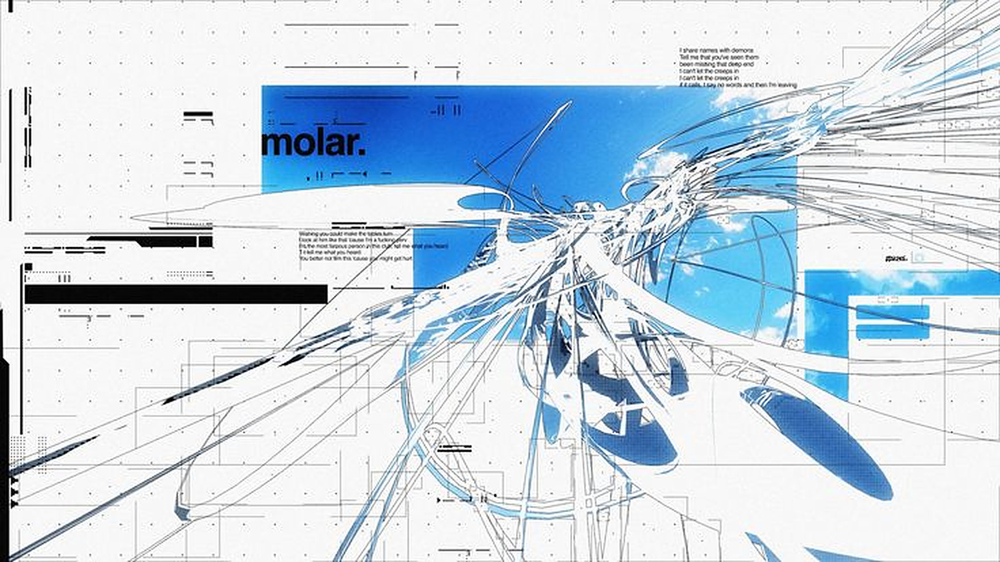
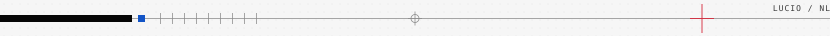
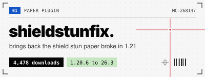
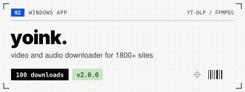
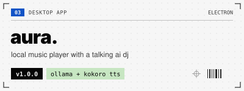
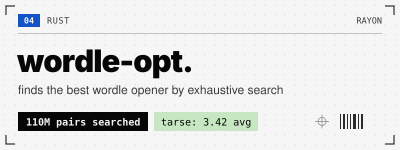
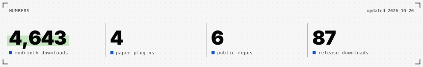

 

### lucio.

`netherlands`

I write Paper plugins for Minecraft servers and small tools for Windows. At home everything runs on a Raspberry Pi 5 NAS that I set up and maintain myself. Side projects in Rust. Outside of that: cybersecurity, and AI that runs on my own hardware.

 

<picture>
  <source media="(prefers-color-scheme: dark)" srcset="assets/divider-dark.svg">
  
</picture>

 

<a href="https://modrinth.com/plugin/shieldstunfix"><picture><source media="(prefers-color-scheme: dark)" srcset="assets/card-shieldstunfix-dark.svg"></picture></a> <a href="https://github.com/LucioTD/Yoink"><picture><source media="(prefers-color-scheme: dark)" srcset="assets/card-yoink-dark.svg"></picture></a>

<a href="https://github.com/LucioTD/Aura"><picture><source media="(prefers-color-scheme: dark)" srcset="assets/card-aura-dark.svg"></picture></a> <a href="https://github.com/LucioTD/wordle-opt"><picture><source media="(prefers-color-scheme: dark)" srcset="assets/card-wordle-opt-dark.svg"></picture></a>

More plugins on [Modrinth](https://modrinth.com/user/LucioTD), more code in my [repos](https://github.com/LucioTD?tab=repositories).

 

<picture>
  <source media="(prefers-color-scheme: dark)" srcset="assets/stats-dark.svg">
  
</picture>
